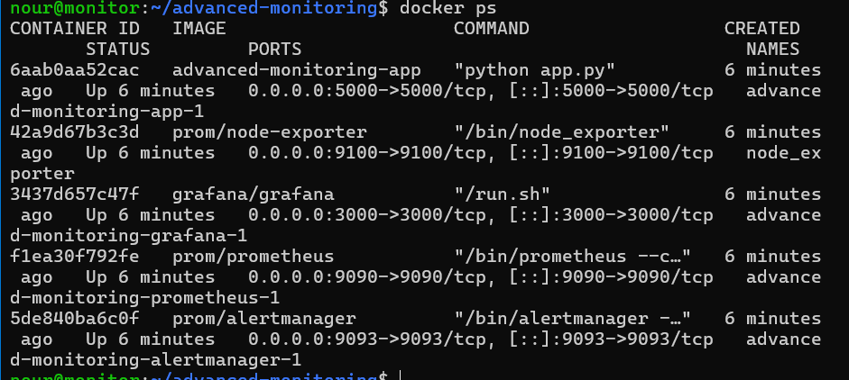
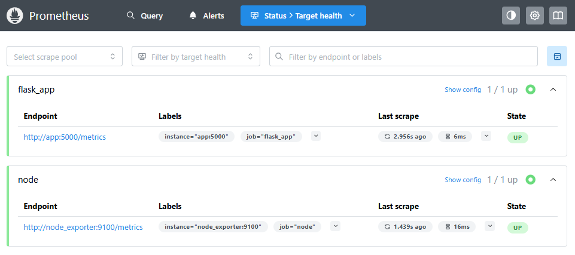
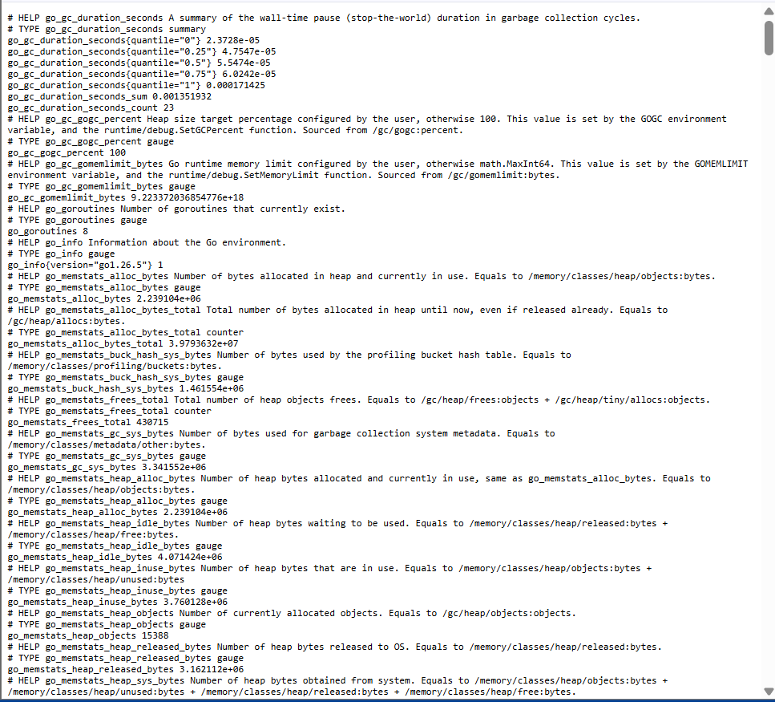
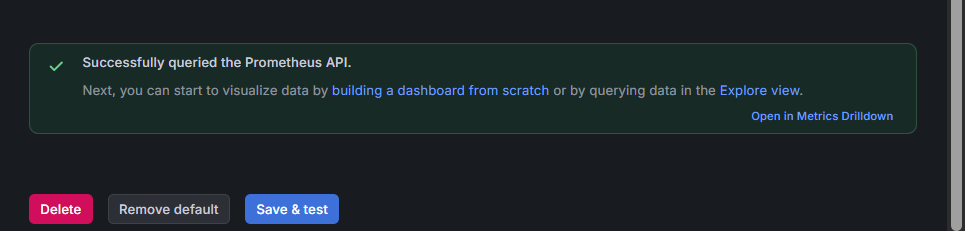

# TP3 – Supervision avancée avec Prometheus, Node Exporter et Alertmanager

**Étudiante :** Nour Kidoudi
**Formation :** Master DevOps et Cloud Computing – ISET Tozeur
**Matière :** Disponibilité des Infrastructures
**Date :** 16/11/2026

---

## 1. Objectifs

- Surveiller l'état du système hôte (CPU, mémoire, disque) avec Node Exporter.
- Créer des alertes dans Prometheus et les gérer avec Alertmanager.
- Visualiser les métriques et les alertes dans Grafana.
- Simuler une panne applicative et une surcharge CPU, puis observer la réaction du système.

## 2. Architecture

Prometheus collecte les métriques de l'application Flask et celles du système via Node Exporter. Les règles d'alerte sont évaluées par Prometheus, qui envoie les alertes déclenchées à Alertmanager. Grafana interroge Prometheus pour les visualisations.

| Service | Rôle | Port |
|---|---|---|
| app (Flask) | Application supervisée, expose `/metrics` | 5000 |
| node_exporter | Métriques du système hôte | 9100 |
| prometheus | Collecte des métriques et évaluation des règles | 9090 |
| alertmanager | Gestion et routage des alertes | 9093 |
| grafana | Tableaux de bord | 3000 |

## 3. Structure du projet

```
advanced-monitoring/
├── docker-compose.yml
├── prometheus.yml
├── alert.rules.yml
├── alertmanager.yml
├── README.md
└── captures/
```

L'application Flask est construite depuis le dossier `../flask-monitoring` (paramètre `build` du service `app`).

## 4. Configuration

- **prometheus.yml** : intervalle de collecte de 5 s, deux jobs (`flask_app` sur `app:5000` et `node` sur `node_exporter:9100`), chargement de `alert.rules.yml` et déclaration d'Alertmanager (`alertmanager:9093`).
- **alert.rules.yml** :
  - `HighCPUUsage` (warning) : utilisation CPU supérieure à 70 % pendant plus d'1 minute.
  - `FlaskAppDown` (critical) : `up{job="flask_app"} == 0` pendant plus de 30 secondes.
- **alertmanager.yml** : récepteur `default` en configuration locale (pas d'envoi externe pour ce TP).

## 5. Démarrage de l'environnement

```bash
cd ~/advanced-monitoring
docker compose up -d --build
docker ps
```



## 6. Vérification des services

- Prometheus : http://localhost:9090
- Alertmanager : http://localhost:9093
- Grafana : http://localhost:3000
- Node Exporter : http://localhost:9100/metrics
- Application Flask : http://localhost:5000

Les deux cibles de collecte sont à l'état **UP** :



Les règles d'alerte sont chargées (état *Inactive* au repos) :


Métriques système exposées par Node Exporter :



## 7. Dashboard Grafana

La source de données Prometheus (`http://prometheus:9090`) a été ajoutée dans Grafana :



Le dashboard contient quatre panneaux :

| Panneau | Requête PromQL |
|---|---|
| CPU | `100 - (avg(rate(node_cpu_seconds_total{mode="idle"}[1m])) * 100)` |
| Mémoire | `(1 - node_memory_MemAvailable_bytes / node_memory_MemTotal_bytes) * 100` |
| Requêtes Flask | `rate(<métrique_flask>[1m])` |
| Alertes actives | `ALERTS{alertstate="firing"}` |


## 8. Test de l'alerte FlaskAppDown

Arrêt de l'application pour simuler une panne :

```bash
docker compose stop app
```


Prometheus ne parvient plus à joindre `app:5000`, la métrique `up` passe à 0 et l'alerte passe en *Pending* :


Après la durée `for: 30s`, l'alerte passe en *Firing* :


Alertmanager reçoit l'alerte :


Redémarrage de l'application, l'alerte est résolue :

```bash
docker compose start app
```


## 9. Test de l'alerte HighCPUUsage

Simulation d'une surcharge CPU dans le conteneur Node Exporter :

```bash
docker exec -it node_exporter sh
yes > /dev/null &
```


Le pic d'utilisation CPU est visible dans Grafana :


Après plus d'une minute au-dessus du seuil, l'alerte `HighCPUUsage` passe en *Firing* :


Arrêt de la charge (`kill %1` puis `exit`) : le CPU redescend et l'alerte est résolue :


## 10. Difficultés rencontrées et solutions

| Problème | Cause | Solution |
|---|---|---|
| `failed to read dockerfile: open Dockerfile: no such file or directory` | `build: ../` pointait vers un dossier sans Dockerfile | Remplacé par `build: ../flask-monitoring` |
| `Bind for 0.0.0.0:9090 / 3000 failed: port is already allocated` | Conteneurs de l'ancien TP encore démarrés | Arrêt avec `docker compose down` dans les anciens projets |
| `docker exec` avec le nom du conteneur de l'énoncé | `container_name: node_exporter` impose ce nom | Utilisation de `node_exporter` |

## 11. Conclusion

Ce TP a permis de mettre en place une chaîne de supervision complète : collecte des métriques applicatives et système avec Prometheus et Node Exporter, définition de règles d'alerte, gestion des alertes avec Alertmanager et visualisation dans Grafana. Les tests de panne (arrêt de l'application) et de surcharge (consommation CPU) ont confirmé que les alertes passent bien par les états *Pending* puis *Firing*, et se résolvent au retour à la normale.
